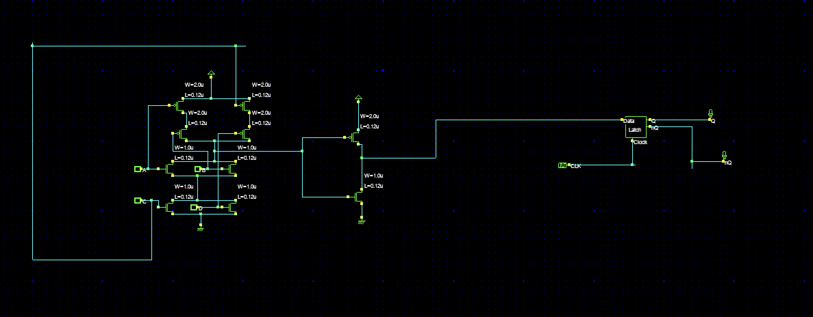
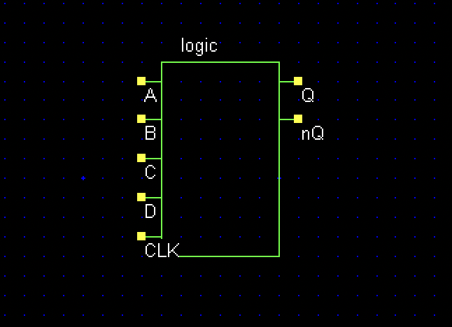
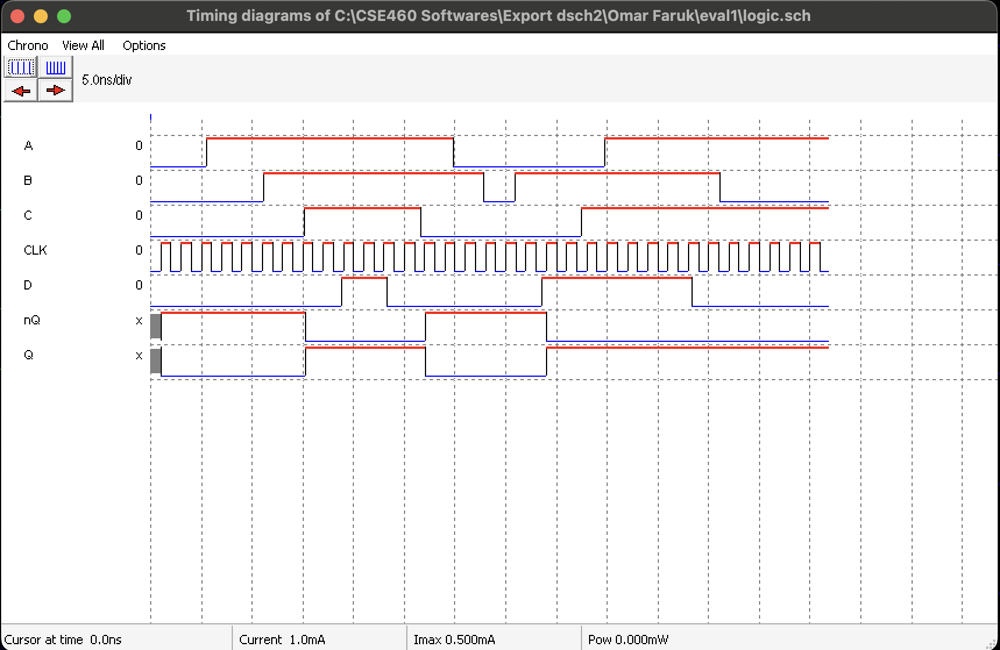

# CSE460 – VLSI Design Lab (BRAC University)

Lab work from CSE460 (VLSI Design) at BRAC University, Spring 2026. Starts
with transistor-level CMOS circuit design in **DSCH2**, then moves to
digital design in **Verilog HDL**, simulated with **Altera Quartus**:
gate-level modeling, combinational circuits, and finite state machines.

Each folder contains my submission (PDF with code, timing diagrams, and
RTL views) where available, my DSCH2 or Verilog source files, and the
assignment or lecture slides.

## Overview

| Lab | Topic | Tool |
|-----|-------|------|
| [Lab 01](#lab-01--cmos-circuit-design-in-dsch2) | CMOS circuit design | DSCH2 |
| [Lab 02](#lab-02--introduction-to-verilog-hdl) | Gate-level Verilog | Quartus |
| [Lab 03](#lab-03--multiplexers-encoders-decoders-and-counters) | Behavioral Verilog: MUX, encoders, counters | Quartus |
| [Lab 04](#lab-04--finite-state-machines) | Moore finite state machine | Quartus |
| [Lab 05](#lab-05--vending-machine-design) | Vending machine FSM | Quartus |
| [Lab Test 1](#lab-test-1) | Code converter and priority encoder | Quartus |
| [Lab Test 2](#lab-test-2) | Vending machine FSM and sequence detector | Quartus |

## Lab 01 – CMOS Circuit Design in DSCH2

Designing logic directly from transistors: a pull-down network of NMOS
transistors and a complementary pull-up network of PMOS transistors. Each
building block was saved as a reusable DSCH2 symbol and then used to build
larger circuits. The `.txt` files are the Verilog netlists that DSCH2
exports for each circuit.

| Circuit | Description | Files (in `Lab01/dsch2/`) |
|---------|-------------|---------------------------|
| CMOS inverter | One PMOS and one NMOS transistor, plus a version driven by a clock input | `inverter.sch` · `inverter.sym` · `inverter.txt` · `inverter_with_clock.sch` |
| 2-input NAND | Two series NMOS (pull-down) and two parallel PMOS (pull-up) transistors | `2_input_NAND.sch` · `.sym` · `.txt` |
| Positive D latch | A level-triggered D latch built from CMOS NAND gates and an inverter | `pos_D_Latch.sch` · `.sym` · `.txt` |
| Positive edge-triggered D flip-flop | Two D latches in a master-slave arrangement | `Pos_D_FlipFlop.sch` · `.sym` · `.txt` |
| D flip-flop with reset | The edge-triggered D flip-flop with a synchronous active-low reset (`resetn` is ANDed with D) | `pos_flipflop_rst.sch` · `.txt` |

### Lab Evaluation 1

A transistor-level CMOS circuit for **F = (A + B) · (C + D)**, whose output is
stored in a clocked latch (a pass transistor with inverter feedback) with outputs Q and nQ. The design
was packaged as the `logic` symbol and verified with a timing diagram.

| Circuit | Symbol | Timing diagram |
|---------|--------|----------------|
|  |  |  |

Files: [logic.sch](Lab01/evaluation1/logic.sch) · [logic.sym](Lab01/evaluation1/logic.sym) · [logic.txt](Lab01/evaluation1/logic.txt)

[Submission](Lab01/Lab01_Submission.pdf) · [Assignment](Lab01/Lab01_Assignment.pdf)

## Lab 02 – Introduction to Verilog HDL

Structural (gate-level) Verilog and simulation in Quartus.

| Work | Description | Code |
|------|-------------|------|
| Gate-level circuit | Implemented f = ((a′ ⊕ b) + c + a·d)′ with `not`, `xor`, `and`, and `nor` gate primitives, and verified it with a timing diagram and the RTL view | [lab02_gate_level_circuit.v](Lab02/lab02_gate_level_circuit.v) |

[Submission](Lab02/Lab02_Submission.pdf) · [Assignment](Lab02/Lab02_Assignment.pdf) · [Slides](Lab02/Lab02_Slides.pdf)

## Lab 03 – Multiplexers, Encoders, Decoders, and Counters

Behavioral Verilog with `if-else` and `case` statements, and blocking (`=`)
vs. non-blocking (`<=`) assignments. This folder contains the lab materials
only.

[Assignment](Lab03/Lab03_Assignment.pdf) · [Slides](Lab03/Lab03_Slides.pdf)

## Lab 04 – Finite State Machines

| Work | Description | Code |
|------|-------------|------|
| Moore sequence detector (0111) | A five-state Moore FSM with an asynchronous active-low reset. The output z goes high after the input sequence 0111 is received | [lab04_moore_sequence_detector_0111.v](Lab04/lab04_moore_sequence_detector_0111.v) |

[Submission](Lab04/Lab04_Submission.pdf) · [Slides](Lab04/Lab04_Slides.pdf)

## Lab 05 – Vending Machine Design

Designing a vending machine as an FSM in Verilog. This folder contains the
lecture slides and the lab assessment question: a **parking fee collection
machine** with four gates (bike Tk 10, car Tk 50, microbus Tk 80, truck
Tk 120) that accepts Tk 0, 10, 20, 50, and 100, adds up the cash, confirms
once the fee is reached, and returns the change. My Verilog solution to the
same kind of problem is the vending machine in [Lab Test 2](#lab-test-2).

[Assessment question](Lab05/Lab05_Assessment_SetA.pdf) · [Slides](Lab05/Lab05_Slides.pdf)

## Lab Test 1

| Task | Description | Code |
|------|-------------|------|
| 1 | **Code converter:** maps a 4-bit input to a 6-bit output (1001 → 22, 1100 → 30, 0110 → 15) using a `case` statement | [task1_code_converter.v](LabTest1/task1_code_converter.v) |
| 2 | **Priority encoder:** a 5-input priority encoder with priority w4 > w0 > w3 > w1 > w2, using `casex` with don't-care bits | [task2_priority_encoder.v](LabTest1/task2_priority_encoder.v) |

[Submission](LabTest1/LabTest1_Submission.pdf)

## Lab Test 2

| Task | Description | Code |
|------|-------------|------|
| 1 | **Vending machine:** a two-state FSM that accepts Tk 10, 20, 50, 100, 200, and 500 notes, keeps a running total across clock cycles, signals a purchase once the total reaches the price, and returns the change | [task1_vending_machine.v](LabTest2/task1_vending_machine.v) |
| 2 | **Moore sequence detector (110):** a four-state Moore FSM that detects the overlapping input sequence 110 | [task2_sequence_detector_110.v](LabTest2/task2_sequence_detector_110.v) |

[Submission](LabTest2/LabTest2_Submission.pdf)

## How to run

- **Verilog (`.v`):** create a project in Altera/Intel Quartus, add the
  file, set its module as the top-level entity, and run a functional
  simulation. The files also work with other Verilog simulators such as
  Icarus Verilog.
- **Lab 01 (`.sch`, `.sym`):** open the schematics in DSCH2 and run the
  simulation to see the timing diagram.

## Tools
Verilog HDL · Altera Quartus · DSCH2
